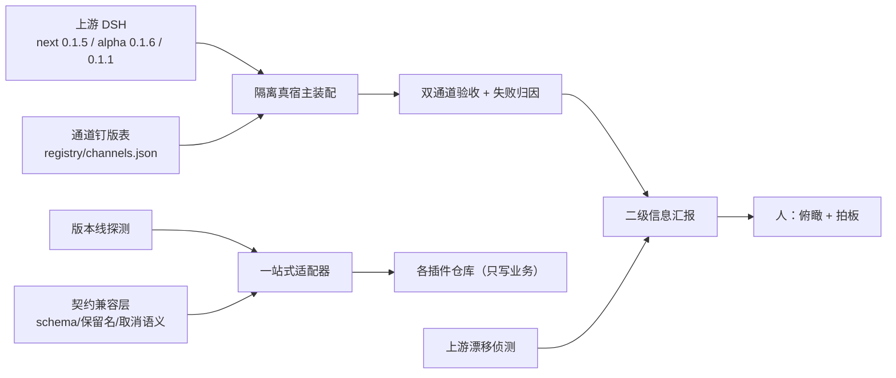

# 🧩 DSH 适配中台（dsh-adapt-hub）

> **把「每个插件都要重复做一遍的 DSH 适配」固化成一处能力。**
> 上游 DSH 一变，只改这里；各插件仓库只写业务，**不再各改一遍**。

[](registry/channels.json)
[](tests/test_hub.sh)

---

## 解决什么问题

其他生态的插件/模式想适配 DSH（DeepSeek Harness）生态，但 DSH **持续变动**：
`0.1.1`（Code mode）→ `0.1.5`（PTC mode）→ `0.1.6-alpha`，每次变更都让每个插件仓库
各自改一遍适配代码。**这份重复劳动价值低，且极易漏改。**

本仓库把重复部分做成**一个功能**，让「适配」这件事集中迭代：

| 重复劳动 | 中台怎么消掉 |
|---|---|
| 探测宿主是新版还是旧版 | `detectHostFlavor()`（零 `@deepseek-ai` import） |
| 宽松 schema 压平为宿主受支持子集 | `normalizeSchema()` + 注册前自检 |
| 规避 `run_code` 保留名 | `assertNotReserved()` 显式报错 |
| 补 `output.render`、尊重 `exec.signal` | 适配器统一处理 |
| 写双版本适配验收脚本 | `verify --channel stable|dev` |
| 盯上游发版 | `watch` + crontab 每日扫 |

---

## 两个版本的能力（双通道）

| 通道 | 版本线 | npmTag | 跑在哪 | 失败含义 |
|---|---|---|---|---|
| **稳定版** `stable` | `0.1.5` | `next` | push / PR | 插件回归，**必须修** |
| **开发版** `dev` | `0.1.6` | `alpha` | push / PR | **归因**：上游漂移 / 插件回归 |
| 历史线 `legacy` | `0.1.1` | — | PR + 周日 crontab | 防「为适配新版把旧版装崩」 |

> `--channel all` = `stable` + `dev` + `legacy`（与页面按钮「三通道」同义）。
>
> **开发版越不稳定，本中台价值越高**——它把「不稳定」变成**可自动侦测、可归因的信号**，
> 而不是等人跑到各个仓库翻日志。

---

## 实测结果（真宿主，非纸面）

```
✅ stable  (0.1.5-rc.2)      17/17 检查通过   flavor=modern
✅ dev     (0.1.6-alpha.2)   17/17 检查通过   flavor=modern
✅ legacy  (0.1.1-rc.2)      17/17 检查通过   flavor=legacy
✅ 离线单测 163 项 + 归因离线回归 495 项 + 发布面自检 43 项 + 归因端到端回归 163 项
✅ 负例插件被正确拦下（保留名冲突显式上报，不静默失效）
✅ 插件写错代码（未初始化字段 / 抛错 getter）→ 判插件且 `hostFatal[]` 为空（插件侧错误不进判据字段——**前提：探针进程内防线未被插件干预**，见 `docs/RISKS.md` R22/R23）
✅ 上游漂移侦测可用（基线只在通道 ok 时更新，失败不覆盖）
```

---

## 快速开始

### 作为插件作者（接入你的插件）

```bash
cp templates/adapter/index.mjs ./index.mjs   # 替换 demo_* 为你的工具
```

```js
import { createAdapter } from '@dongdongxiaozu/dsh-adapt-hub';
export const inject = ['tools'];
export function apply(ctx) {
  const adapter = createAdapter(ctx, { prefix: 'myplugin' });
  adapter.register([ /* 纯业务工具定义 */ ]);
}
```

详见 [`docs/ADAPTER_GUIDE.md`](docs/ADAPTER_GUIDE.md)。

### 作为验收者（跑双通道）

```bash
node src/cli.mjs matrix                                  # 看通道矩阵
node src/cli.mjs verify --channel all --plugin ./tests/fixtures/demo-plugin.mjs --tools demo_echo,demo_status --markdown
node src/cli.mjs watch                                   # 上游有没有发新版
bash tests/test_offline.sh                               # 离线单测（163 项，秒级）
node tests/test_attribution.mjs                          # 归因离线回归（495 项，秒级）
node tests/test_exports.mjs                              # 发布面自检（exports 全解析 + 模板拷贝可用）
```

### 作为人类观察者

- 页面按钮：**双通道验收** / **上游漂移侦测**（见 `.cnb/web_trigger.yml`）
- 二级信息看板：`node src/cli.mjs report --plugin ... --tools ... --markdown`

---

## 架构一图



完整设计见 [`docs/ARCHITECTURE.md`](docs/ARCHITECTURE.md)（架构八步交付物）。

---

## 文档索引

| 文档 | 内容 |
|---|---|
| [`docs/ARCHITECTURE.md`](docs/ARCHITECTURE.md) | 架构八步：调研→拓扑→可行性→工程→分工→进度→索引→复盘 |
| [`docs/ADAPTER_GUIDE.md`](docs/ADAPTER_GUIDE.md) | 插件 5 分钟接入 + 归因怎么读 |
| [`docs/RISKS.md`](docs/RISKS.md) | 风险清单（等级/触发条件/规避/兜底）+ 待拍板项；**R26 = 架构前提（插件为可信代码）** |
| [`docs/REDO-PROPOSAL.md`](docs/REDO-PROPOSAL.md) | 结构性重做一页方案（批 1 已落地 / 批 2 进程隔离**已立项在办**） |
| [`docs/INDEX.md`](docs/INDEX.md) | 一页找齐（产物/通道/检查项索引） |
| [`registry/channels.json`](registry/channels.json) | ★ 通道钉版表（唯一事实源） |

---

## 目录结构

```
src/
├── cli.mjs                  # matrix / verify / watch / report / detect
├── adapter.mjs              # 插件侧唯一 import 面
├── detect/flavor.mjs        # 版本线探测（ptc/code/unknown）
├── compat/                  # schema 压平 + 工具契约适配
├── harness/                 # 隔离真宿主装配 + 17 项探针（+9 条件项）+ nonce 带外通道 + fd3 结果通道 + 契约指纹采集
├── verify/runner.mjs        # 双通道验收 + 归因
├── watch/upstream.mjs       # 上游漂移侦测 + 契约指纹 diff
└── report/secondary.mjs     # 二级信息汇报（JSON + Markdown）
registry/                    # 通道钉版表 + 契约指纹基线
templates/adapter/           # 新插件接入模板
tests/                       # 离线单测 + 双通道验收编排 + 示例/负例插件
docs/                        # 架构 / 接入 / 风险 / 索引
.cnb.yml + .cnb/web_trigger.yml  # push / PR / crontab / 页面按钮
```

---

## 能力边界（显式声明，不越权）

> ⚠️ **架构前提（必读，评审复评 🟡-4 / 总师 §3-Q2）**：本中台的**全部结论**都以
> **「被测插件为可信代码」**为前提。探针与插件跑在**同一进程、同一组输出面**上——
> 插件（或**其依赖**）若主动伪造结构化结果标记、摘掉探针的进程级防线、或在探针写出报告前退出，
> **探针结论即不可信**（实测：插件可伪造 17 项全绿并拿到 `ok=true`）。
> 这不是探针 bug，而是**架构前提被打破**——本中台是**验收**工具，**不是沙箱**。
> ⇒ **不得**在缺少该前提的情况下宣称「报告可信」；根治方向（进程隔离）
> 见 [`docs/REDO-PROPOSAL.md`](docs/REDO-PROPOSAL.md)，对应风险 `docs/RISKS.md` **R26（HIGH）**。

**能做**：契约层适配、双通道验收、上游侦测、归因、汇报。

**不做（暂缓，非遗忘）**：
- npm 包发布（需人拍板发布策略）
- 组织级跨仓批量体检（需人拍板授权范围）
- PTC-only SDK 语义增强（上游仍在 alpha，过早绑定 = 新的适配债）

详见 [`docs/RISKS.md`](docs/RISKS.md) 的「待人类拍板项」。
