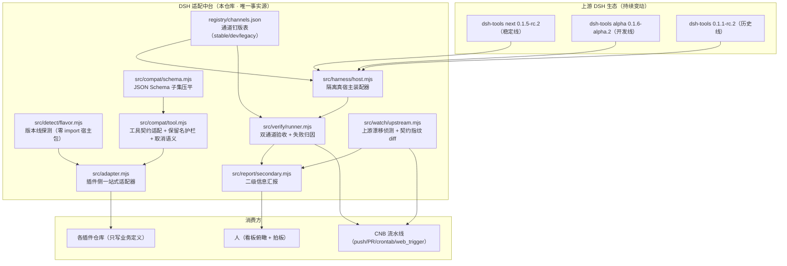

# DSH 适配中台 · 架构设计（架构八步交付物）

> Issue: #1「dsh适配的通用改造的架构」
> 角色：架构·总师 ｜ 状态：**CP1 已自验通过，待 CP2 人批准进入推广**
> 版本：`dsh-adapt-hub v0.3.1`（module `adapt-hub`；**v0.3.1（基线「地铁」模型）**：把 `composeChain()` 的**单轴**链条升级为**每通道一条线路**——① 每条线有自己的**出发点**（首次出现的分片）；② 只有**显式声明**才算**站点**（未声明 ≠ 站）；③ 合并不是「全部取最新」，而是**沿各自线路从出发点推进到末站**；④ 单轴**看不见**的偏差被**显式化**：末站之后无站点的通道 ⇒ `carried`（前向携带 `from→to`）+ `endedLines`（已停运线），**不再静默**；⑤ `composeMetro()` 是 `composeChain()` 的**严格上位**，**解耦优先**：**取值面**（`contracts`/`perChannel`）与 `composeChain()` **同判据（`isUsableStation()` = `isUsableContract()`）、同顺序、逐键逐值相同**（畸形/半截快照照样留在取值里）；**注解面**（`stations`/`carried`/`endedLines`）才用更严的 `hasContractFingerprint()`，不达标者记入 `shallowStations`**显式留痕**；末站取链上最后一个被接受的快照 ⇒ 取值来源不漂移；删除无消费方的 `metroContracts`（唯一取值事实源 = `contracts`）；⑥ **advice 面，不参与归因判据**（守卫 B6）。新增守卫 B6 + 离线 [24]（16 项语义断言 + 4 条守卫自证）。**v0.3.0（基线分段）**：把「**每跑一次就改写基线**」改成「**按周期分片 + 顺序链式合并**」——① 默认**一天一个基线**（周期键 = 当日结算点日期，`settleHour` 默认 10 点，满足「早晨 10 点结算一天」）；② 可切 `release` 模式（**每个上游版本**建立**独自**基线）；③ 同周期多个候选**取相对早的那个**（`first-wins`，后跑的不覆盖 ⇒ 防「跑得越多、基线越偏」）；④ 每周期写**独立分片** `registry/contract-snapshots/segments/<周期>.json`，**不合主线**；⑤ `latest` 变成**派生**结果：分片按周期**早→晚依次合并**（后周期只覆盖自己声明的通道，前周期未覆盖的原样保留）——「连起来」才是最新版，**不是**「全部取最新再合成」；⑥ `verify` **只读**基线，**唯一写入点**是 `settle`（CI 上每日 10:00 crontab）；⑦ 历史遗留 `latest.json` 可 `baseline --migrate` 一次性迁成分片（幂等，且固定排在链最前）。新增守卫 `tests/test_baseline_guard.mjs`（B1–B5 + 守卫自证）。v0.2.9（收尾）：docs/INDEX.md §二 产物索引表**完整性修复 + 防线化** —— 实测该表被合并漂移**劈成两段**（空行）且有 **3 行重复**（`归因端到端回归` ×2、`负例插件（H1/R28 防线干预）`/`负例插件（R24 同步死循环）` ×2）⇒ 既有守卫只覆盖 §四 17 项清单与 §二条件检查表，**产物索引表整块无守卫**；本版补齐并新增防线 `[2d]`（表块连续 / 整行不重复 / 首列不撞名 + 三条守卫自证 + 两组真实变异拦下）。v0.2.8：本线 = 评审 §三 **4.2** —— 结果行**不回显 nonce**，改**正文绑定**逐行认证标签 `HMAC-SHA256(nonce, 正文)`（凭据**不可迁移**）+ 判据增补「stdout 无一条凭据有效」路径 + **双回退自证**；并行线 = 复评 **🟡-1/🟡-2/🟡-4** 防线化（`killSignal` **逐站点**源码守卫 / `[17]` 数值断言空值假绿收口 / 🔴-5 跨产物扫描扩面）；**归因更正**：nonce 保密性**不是唯一防线**。v0.2.7：**v0.2.7：🔴-R3′ 4.2 并入（凭据不可迁移）**——结果行**不再回显 nonce**，改为**正文绑定**的逐行认证标签 `HMAC-SHA256(nonce, 正文)`（宿主用自己已知的 nonce 重算并逐字比对）⇒ 通道重定向形态下「偷到真报告」也**伪造不出新正文**；判据增补「stdout 上无一条结果行凭据有效」这条独立触发路径；**双回退自证**（只关判据仍 RED；判据 + 凭据一起退回才复现旧实现的 GREEN）⇒「两条腿都承重」。**归因更正**：nonce 保密性**不是唯一防线**。v0.2.6（🔴-R3，两条并行线**取并集**）**：① **主判据**（**宿主侧观测** `resultChannelProvided`，取自唯一事实源 `probeSpawnOptions().stdio[3] === 'pipe'`——**不依赖探针自报** ⇒ 覆盖「报告被整体改写 / 无 `resultChannel` 字段」的形态）；② **辅判据**（报告**自称**走 fd3 而宿主侧该通道无内容）；③ **能力实测分支**（宿主侧 fd3 能力独立实测 `probeFd3Capability()`，每进程记忆化 ⇒ 自报降级而实测可用 = 矛盾）；④ **宿主侧观测分支**（本次已给 fd3 管道却自报降级 = 矛盾）——③④ 收口 **§三 同源形态「自报降级 ⇒ 甩锅上游」**（收口前实测 `AMBER`/`UPSTREAM_DRIFT`）；⑤ 形态可见值 `RESULT_CHANNEL_FD3_REDIRECTED = 'fd3-redirected'`（**宿主侧观测结论**，与「降级」显式分开）；⑥ 协议注入三条判据收敛为**单一落点** `markProtocolInjection()`。夹具 `plugin-channel-redirect-plugin`（三形态）+ `plugin-channel-degrade-forge-plugin` **进闸门**。v0.2.5：🔴-R3′（报告**自称**判据 + 压退出码）；v0.2.4：R26 残留边界②（fail-open）登记 + 批 2 首要目标并入；v0.2.3：批 1.5 + 评审复评并集（可达性口径更正 + 通道可见化 + §3 反例固化 + exit 钩子台账 + 🔴-A 无 nonce 硬崩收口 R30 + 🔴 必修-4 同族假绿收口 R29）；v0.2.2：nonce 通道改 **stdin**；v0.2.1：信任边界写成显式前提 + 结构性重做一页方案；v0.2.0：R24 `killSignal:SIGKILL` 有界 + R26 协议注入（nonce + fd3）+ R28 防线自检；批 2 在办**）

> 版本：`dsh-adapt-hub v0.2.7`（module `adapt-hub`；**v0.2.7：评审复评 🟡-1/🟡-2/🟡-4 防线化**——① `killSignal` **逐站点**源码守卫（站点①`probeSpawnOptions` 返回对象 / 站点②npm `execFileSync` 本次选项，括号配平取实参列表 + 三条守卫自证；修「`[17]` 只守了替身」）；② `[17]` 数值断言先 `^[0-9]+$` 再比大小（修空值假绿）+ 三条守卫自证；③ 🔴-5 跨产物扫描**扩面**到 `tests/*.sh` / `tests/*.mjs` / `.cnb.yml` / `RISKS` / `ARCHITECTURE` / `README`，识别口径分两类（代码产物只认字符串字面量内容 + `stripComments`；文档产物认裸词并排除方法调用）+ 五条注入自证 + 三条反向护栏；**v0.2.6（🔴-R3，两条并行线**取并集**）**：① **主判据**（**宿主侧观测** `resultChannelProvided`，取自唯一事实源 `probeSpawnOptions().stdio[3] === 'pipe'`——**不依赖探针自报** ⇒ 覆盖「报告被整体改写 / 无 `resultChannel` 字段」的形态）；② **辅判据**（报告**自称**走 fd3 而宿主侧该通道无内容）；③ **能力实测分支**（宿主侧 fd3 能力独立实测 `probeFd3Capability()`，每进程记忆化 ⇒ 自报降级而实测可用 = 矛盾）；④ **宿主侧观测分支**（本次已给 fd3 管道却自报降级 = 矛盾）——③④ 收口 **§三 同源形态「自报降级 ⇒ 甩锅上游」**（收口前实测 `AMBER`/`UPSTREAM_DRIFT`）；⑤ 形态可见值 `RESULT_CHANNEL_FD3_REDIRECTED = 'fd3-redirected'`（**宿主侧观测结论**，与「降级」显式分开）；⑥ 协议注入三条判据收敛为**单一落点** `markProtocolInjection()`。夹具 `plugin-channel-redirect-plugin`（三形态）+ `plugin-channel-degrade-forge-plugin` **进闸门**。v0.2.5：🔴-R3′（报告**自称**判据 + 压退出码）；v0.2.4：R26 残留边界②（fail-open）登记 + 批 2 首要目标并入；v0.2.3：批 1.5 + 评审复评并集（可达性口径更正 + 通道可见化 + §3 反例固化 + exit 钩子台账 + 🔴-A 无 nonce 硬崩收口 R30 + 🔴 必修-4 同族假绿收口 R29）；v0.2.2：nonce 通道改 **stdin**；v0.2.1：信任边界写成显式前提 + 结构性重做一页方案；v0.2.0：R24 `killSignal:SIGKILL` 有界 + R26 协议注入（nonce + fd3）+ R28 防线自检；批 2 在办**）

---

## 0. 结论先行

**要做的事**：把「每个插件各自重复做一遍 DSH 适配」的重复劳动，抽成**一处可复用能力**；
上游（DSH）一变，只改这一处，各插件仓库不再各改一遍。

**两个版本的能力**（用户原话的直接落地）：

| 能力 | 含义 | 验收口径 |
|---|---|---|
| **稳定版通道** | 对齐 DSH 稳定线（当前 `next` = `0.1.5-rc.2`） | **必须通过**；失败 = 插件回归，必须修 |
| **开发版通道** | 对齐 DSH 开发线（当前 `alpha` = `0.1.6-alpha.2`） | **必须跑**；失败时**归因**：上游漂移 / 插件回归 |

**关键判断**：开发版通道越不稳定，本中台价值越高——它把「不稳定」变成**可自动侦测的信号**，
而不是等人到各个仓库去翻日志。这正是用户点出的「适配了它的不稳定才需要频繁调整」。

**已实测跑通**（非纸面设计）：

```
stable(0.1.5-rc.2)  ✅ 17/17 检查通过   flavor=modern
dev   (0.1.6-alpha.2) ✅ 17/17 检查通过   flavor=modern
legacy(0.1.1-rc.2)  ✅ 17/17 检查通过   flavor=legacy
离线单测 249 项 + 归因离线回归 654 项 + 发布面自检 51 项 + 基线分段守卫 36 项 ✅   归因端到端回归 191 项 ✅   负例插件被正确拦下 ✅   上游侦测 + 影响面自动归因可用（基线防自毁）✅   🚇 基线「地铁」线路图可用（防「未声明通道被静默前向携带」）✅

```

---

## 一、调研（Step 1）

### 1.1 需求方（人）要什么

| 诉求（原话拆解） | 落地为 |
|---|---|
| 「其他生态的插件想适配 dsh 生态」 | 插件侧只写业务定义，适配逻辑收归中台 |
| 「dsh 生态持续变动 → 频繁改适配」 | 版本线探测 + 契约兼容层 + 契约指纹漂移侦测 |
| 「重复劳动价值低，应形成功能」 | 一个可被 N 个仓库调用的适配中台（桥头堡），不是 N 份复制脚本 |
| 「两个版本的能力：稳定版 / 开发版」 | 双通道验收（stable / dev），另有 legacy 历史线守门 |
| 「开发版不稳定，价值更高」 | dev 通道必跑 + **失败归因**（上游漂移 ≠ 插件 bug） |
| 「跟着官方文档和新版本做适配」 | 钉版表 + dist-tag 侦测 + crontab 每日扫描 |

### 1.2 现状（调研实测，非推测）

**A. CNB 平台侧能力**（来源：官方文档 `docs.cnb.cool`）

| 能力 | 用途 | 文档 |
|---|---|---|
| `web_trigger` | 页面按钮手动触发 + `inputs` 传参（支持 `select` 等 8 种类型） | `/zh/build/web-trigger` |
| `crontab:` 事件 | 定时侦测上游漂移（最小间隔 5 分钟） | `/zh/build/crontab` |
| `include` / `imports` / `optionsFrom` / `settingsFrom` | 跨仓库引用模板与配置（桥头堡调用链） | `/zh/build/file-reference` |
| `api_trigger` + `npc.name` | 外部系统以 NPC 身份触发流水线 | `/zh/build/npc-integration` |
| `npc:go` + Skills | AI 驱动的自动化任务 | `/zh/build/internal-steps/npc/go` |

**B. DSH（DeepSeek Harness）上游现状**（npm registry 实测）

| 包 | dist-tags 实测 | 说明 |
|---|---|---|
| `@deepseek-ai/dsh-tools` | `latest=0.0.1-rc.1`（残留）/ `next=0.1.5-rc.2` / `alpha=0.1.6-alpha.2` | **`latest` 是历史残留，不可作为稳定线判据** |
| `@deepseek-ai/dsh` | `latest=0.1.5-rc.2` / `alpha=0.1.6-alpha.2` | CLI（profile / plugin 管理） |
| `@deepseek-ai/cordis` | `latest=4.0.2` | 插件容器 |

**C. 兄弟仓库已有实践**（调研，避免重复造轮子）

| 仓库 | 已有什么 | 与本中台关系 |
|---|---|---|
| `dongdongxiaozu/dsh-OpenLiulan` | `scripts/dsh-compat-check.mjs`：**单插件自建**的双版本适配验收 | 本中台把该模式**抽成通用能力**（其双版本思路已被验证可行） |
| `dongdongxiaozu/cangkutongyongzhichiku` | 桥头堡调用链（跨仓 `depends_on` 消费能力） | 本中台按同一「调用而非复制」原则分发 |
| `dongdongxiaozu/dongjiagoushi` | `docs/PLATFORM_ADAPTERS.md` 三入口归一化 | 本中台是其「DSH 宿主」侧的**契约层实现** |
| `dongdongxiaozu/tongyongyuanjiagoshikuangjia` | 框架/行业/整合解耦布局 | 本中台可视为「框架库」的一个基础能力 |

**结论**：DSH 适配的痛点真实存在、已有单点实践、但**缺通用中台**——本 Issue 要做的就是这个缺口。

---

## 二、顶层架构拓扑（Step 2）



### 模块清单（边界 / 依赖 / 输入输出 / 风险）

| 模块 | 文件 | 输入 | 输出 | 依赖 | 风险 |
|---|---|---|---|---|---|
| **通道钉版表** | `registry/channels.json` | 人工/侦测更新 | 通道定义 + 钉版 | 无 | [MEDIUM] 钉版过期 → 由 crontab 侦测兜住 |
| **版本线探测** | `src/detect/flavor.mjs` | `ctx.tools` 实例 | `HostProfile{flavor,evidence,signals}` | 无（零宿主 import） | [LOW] 上游改 `Config` 形状 → 有兜底指纹 + unknown 不抛错 |
| **Schema 兼容** | `src/compat/schema.mjs` | 宽松 schema | 受支持子集 schema + 违规清单 | 无 | [LOW] 子集收窄 → 违规清单显式上报 |
| **工具契约适配** | `src/compat/tool.mjs` | 作者侧工具定义 | 宿主可注册定义 | schema.mjs | [LOW] 保留名扩充 → 白名单可配置 |
| **一站式适配器** | `src/adapter.mjs` | `ctx` + 工具定义 | 注册结果 + disposer | compat/detect | [LOW] 插件侧唯一 import 面，接口稳定优先 |
| **隔离宿主装配** | `src/harness/host.mjs` | 通道 + 插件路径 | 探针结果（真宿主） | node/npm | [MEDIUM] 需网络装宿主 → 缓存 + 离线模式 |
| **双通道验收** | `src/verify/runner.mjs` | 通道 + 插件 | 报告 + 归因 | harness | [LOW] 归因误判 → 保守策略（宁可报上游漂移） |
| **上游侦测** | `src/watch/upstream.mjs` | npm registry | 漂移清单 + 契约 diff | 网络 | [MEDIUM] 网络不可达 → 返回 `offline:true`，不静默通过 |
| **基线「地铁」视图** | `src/watch/baseline.mjs`（`composeMetro()`） | 分片数组 | 每通道线路图（出发点 / 站点[指纹齐全] / 末站 / 前向携带 / 停运线 / 空壳快照）；取值面与 `composeChain()` 逐键一致，注解面更严 | 无 | [LOW] **advice 面**，不参与归因判据（守卫 B6 守住） |
| **二级信息汇报** | `src/report/secondary.mjs` | 验收报告 | JSON + Markdown 双视图 | 无 | [LOW] — |
| **CLI** | `src/cli.mjs` | 子命令 | 退出码 + JSON/Markdown | 以上全部 | [LOW] — |

---

## 三、可行性验证（Step 3）

**原则**：关键假设必须**用真宿主跑通**，不接受「应该没问题」。

| # | 假设 | 验证方式 | 结论 |
|---|---|---|---|
| A1 | 新旧版可同产物兼容（插件不 import 宿主包） | 隔离目录各装真宿主，装同一份插件产物 | ✅ **可行**（三通道各 17/17） |
| A2 | 版本线可探测且无需 import | 读 `tools.constructor.Config.toString()` | ✅ 可行：`ptc`→modern、`code`→legacy |
| A3 | 保留名 `run_code` 在新旧版都被拒 | 实测 `register({name:'run_code'})` | ✅ 两版均拒（措辞不同：PTC mode / Code Mode） |
| A4 | `output.schema` 受强制子集校验 | 实测注册 `{type:'json'}` | ✅ 两版均拒，措辞一致 |
| A5 | `output` 必须声明 `{schema, render}` | 实测只给 `schema` | ✅ 两版均拒（`render` 必需） |
| A6 | `exec.signal` 取消语义在新旧版均生效 | 中止后调 `execute` | ✅ 两版均 `isError=true` |
| A7 | `latest` dist-tag 可作稳定线判据 | 实测 npm dist-tags | ❌ **不可**：`dsh-tools@latest` 停在 `0.0.1-rc.1`（残留），改用 `next` |
| A8 | CNB 能跨仓库复用本中台（非复制） | 读官方 `include` / 桥头堡文档 | ✅ 可行（`include` + `optionsFrom`；跨私有仓需 `allow_slugs`） |
| A9 | `crontab` 可做上游每日侦测 | 读官方文档（最小间隔 5 分钟） | ✅ 可行（本仓用每日 03:30） |
| A10 | `web_trigger` 可传参做手动验收 | 读官方文档（8 种 `inputs` 类型） | ✅ 可行（已配按钮，含 `select` 通道选择） |

**暂缓项（显式标注，不静默）**：

| 项 | 原因 | 何时做 |
|---|---|---|
| npm 包发布（`@dongdongxiaozu/dsh-adapt-hub`） | 需人拍板发布策略与包名归属 | CP2 后 |
| 一键批量体检 N 个插件仓库 | 需先确认插件清单与跨仓授权（组织级开关） | CP2 后 |
| PTC-only SDK 语义增强（`presentAs('ptc')` 等） | 上游仍在 alpha，过早绑定 = 新的适配债 | 上游进入 rc 后 |

---

## 四、工程实施方案（Step 4）

### 4.1 目录结构

```
tongyongzhuandshshipei/
├── package.json                       # @dongdongxiaozu/dsh-adapt-hub（bin: dsh-adapt）
├── .cnb.yml                           # push/PR 双通道验收 + crontab 漂移侦测 + web_trigger
├── .cnb/web_trigger.yml               # 页面按钮：双通道验收 / 上游漂移侦测
├── registry/
│   ├── channels.json                  # ★ 通道钉版表（唯一事实源）
│   └── contract-snapshots/latest.json # ★ 契约指纹基线（漂移对比用）
├── src/
│   ├── cli.mjs                        # matrix / verify / watch / report / detect
│   ├── adapter.mjs                    # 插件侧唯一 import 面
│   ├── index.mjs                      # 公共导出
│   ├── detect/{index.mjs,flavor.mjs}  # 版本线探测（+ 导出面）
│   ├── compat/{schema,tool}.mjs       # 契约兼容层
│   ├── harness/{host.mjs,probe-template.mjs}  # 隔离真宿主装配 + 探针
│   ├── verify/runner.mjs              # 双通道验收 + 归因（漂移相关性表**不在此硬编码**）
│   ├── triage/index.mjs               # ★ 上游漂移**自动归因影响面**（唯一事实源：DRIFT_IMPACT）
│   ├── watch/upstream.mjs             # 上游侦测 + 契约 diff
│   └── report/secondary.mjs           # 二级信息汇报
├── templates/adapter/                 # 新插件接入模板（拷贝即用）
├── tests/
│   ├── test_offline.sh                # 249 项离线单测（无网可跑；含 [13] verdict 优先级 / [14] 漂移相关性表唯一事实源 / [15] watch 影响面 / [16] 🔴 四条出口离线探针回归 + 🔴-A 无 nonce 不硬崩 / [17] 🔴-1 占死事件循环有界返回 / [18] nonce 侧信道 + v0.1.9d 三形态 / [19] 批 1.5 通道可见化+降级不放行+§3 反例+exit 台账 / [20] 🔴 必修-4 同族假绿 / [21] 🔴-R3′ 通道重定向 + 压退出码 + 🔴-R3③ 自报降级甩锅 / [22] 🔴-R3 宿主侧观测主判据 + §三 自报降级 / [23] 契约基线分段 / [24] 基线「地铁」模型）
│   ├── test_attribution.mjs           # 654 项归因离线回归（契约采集无残留 + 判据只读结构化字段 + 硬证据优先 + 🔴-D 相位路由 + 🔴 四条出口/完成位 [9.9] + §四 反向护栏 + ARCHITECTURE 判据表守卫 [7b] + 漂移表唯一事实源 [7c] + triage 影响面 [9] + [9.10]-[9.17] R28/R26/R24/🔴 必修-4/R26 残留② fail-open/🔴-R3′ 通道重定向/🔴-R3③ 自报降级甩锅/🔴-R3 宿主侧观测）
│   ├── test_e2e_regression.mjs        # 191 项归因端到端回归（真宿主；🔴-A / 🔴-B / 🔴-C / 🔴-D + 🔴 必修-2/3 四条出口复现 + [8d]-[8i] 侧信道/R28/R26/R24/§3 反例/🔴 必修-4/🔴-R3′ 通道重定向/🔴-R3③ 自报降级甩锅，含 verdict 与完成位断言）

│   ├── test_exports.mjs               # 发布面自检（exports 全解析 + 模板拷贝可用）
│   ├── test_hub.sh                    # 双通道真宿主验收编排
│   └── fixtures/{demo,broken,plugin-side-throw,plugin-registry-throw,plugin-async-throw,plugin-async-reject}-plugin.mjs
└── docs/{ARCHITECTURE,ADAPTER_GUIDE,RISKS,INDEX}.md
```

### 4.2 接口契约（对外承诺，改动需走版本号）

**① 插件侧（唯一需要 import 的面）**

```js
// 推荐子路径（也可从根导出面取，二者等价）
import { createAdapter } from '@dongdongxiaozu/dsh-adapt-hub/adapter';

export const inject = ['tools'];                    // 新旧版语义一致

export function apply(ctx) {
  const adapter = createAdapter(ctx, { prefix: 'myplugin' });
  adapter.register([
    {
      name: 'myplugin_echo',                        // 不得命中保留名（run_code）
      description: '...',
      parameters: { type: 'object', properties: { text: { type: 'string' } } },
      output: { schema: { type: 'object', properties: { text: { type: 'string' } } } }, // render 可省略
      execute: async (args, exec) => ({ text: args.text }),                            // exec.signal 自动守
    },
  ]);
}
```

**② CLI 契约（退出码即信号）**

| 命令 | 退出码 | 含义 |
|---|---|---|
| `dsh-adapt matrix` | 0 | 打印通道矩阵 |
| `dsh-adapt verify --channel stable\|dev\|legacy\|all` | 0 = GREEN；1 = 有失败；2 = 用法/参数错误 | 验收（`all` = stable+dev+legacy） |
| `dsh-adapt watch [--json <out>] [--markdown] [--contract-from <verify-json>]` | 0 = 无漂移；1 = 有漂移（版本或契约）；2 = 离线 | 上游侦测 **+ 自动归因影响面**（`--markdown` 出人类视图） |
| `dsh-adapt settle --from <verify.json> [--mode day\|release] [--dry-run]` | 0 | ★ **唯一写基线**（结算）；`--dry-run` 不落盘 |
| `dsh-adapt baseline [--migrate] [--json <out>] [--markdown]` | 0 | 看基线链 + 🚇 **地铁线路图**（每通道一条线，含出发点/站点/末站/前向携带）；`--migrate` 迁遗留 |
| `dsh-adapt report --markdown` | 同 verify | 二级信息 |

**③ 归因契约（`verify` 报告，机器可读）**

判据按优先级（**只读结构化字段与 check 名**；`errors[]` 是纯人读日志，**任何判据不读**）：

| 优先级 | 证据 | 归因 |
|---|---|---|
| 1 | **结构化字段 `hostFatal[]` 非空**（`HOST_FATAL_FIELD`），或失败项属 `HOST_SIDE_CHECKS`（`host.tools_ready` / `detect.flavor_known` / `contract.probe_disposed`） | `UPSTREAM_DRIFT` |
| **1b** | **完成位缺失**（`runCompleted === false`）且无失败项、`checks` 非空 —— 探针跑过但**没跑完**（插件提前 `process.exit` / 挂住事件循环 / 不可捕获终止）；未跑到的检查是 `skip` 而非 `fail`，**不得**据此判通过（假绿比 AMBER 更危险） | `PLUGIN_REGRESSION` |
| 2 | 版本线探测为 `unknown` | `UPSTREAM_DRIFT` |
| **2b** | 失败项属 **`PLUGIN_HARD_EVIDENCE`**（`guard.reserved_rejected`）—— 插件违反宿主硬约束，**优先于任何漂移相关性** | `PLUGIN_REGRESSION` |
| 3 | 契约指纹漂移，且漂移字段与失败 check **一一对应**（`reservedName`↔`guard.reserved_name`、`schemaSubset`↔`compat.schema_flatten`、`configProjection`↔`detect.flavor_known`、`outputShape`↔`dispatch.*`） | `UPSTREAM_DRIFT` |
| 4 | 契约 check 失败且**无可用基线**（首次采集，无法判定上游） | `UPSTREAM_DRIFT`（保守） |
| 5 | 失败项属 `PLUGIN_SIDE_CHECKS` / `CONTRACT_SIDE_CHECKS`（基线一致） | `PLUGIN_REGRESSION` |
| 6 | 有失败但无可识别 check（被外力中断等） | `UNKNOWN`（不猜、不甩锅） |

> **写入端纪律（🔴-D / 🔴 必修-2/3）**：`hostFatal[]` 是判据唯一事实字段，它的**写入端**必须分相位——
> 探针执行分 `host-assembly`（宿主包 import / Context 装配 / 契约采集）与 `plugin-integration`
> （插件 import / apply / definitions / dispatch / 生命周期）两段；探针兜底按相位归因：
> `host-assembly` 的未预期异常 → `hostFatal[]`；`plugin-integration` 的 → **插件侧 check**
> （同步 `plugin.unexpected_exception` / 异步 `plugin.async_uncaught_exception`），
> **绝不**进 `hostFatal[]`。
> 读插件侧数据的两处（`tools.schemas()` / `definitions.map()`）另有独立护栏，异常落
> `registry.exact` / `guard.reserved_rejected`。历史缺陷：顶层 catch 一律 `pushHostFatal()`，
> 插件 bug（未初始化字段 / 抛错 getter）被写成宿主信号 → 判 `UPSTREAM_DRIFT`/AMBER，
> 并盖掉插件侧已失败的 check。归属路由的唯一事实源：`src/harness/contract.mjs` 的
> `PROBE_PHASE` / `probeFailureRoute()` / `probeProcessFailureRoute()` / `recordProbeException()` /
> `recordProbeAsyncException()` / `recordProbeEarlyExit()` / `recordProbeRunIncomplete()`。
>
> **不变量（收窄后的准确口径）**：插件侧错误**不得**进 `hostFatal[]`——探针**可捕获**的全部
> 逃逸形态（①②③④）都落插件侧 check；唯一例外是**不可捕获**的进程级终止（按信标归因，见下）。
>
> **两层兜底（同族活口：异步异常）**：只有**同步**异常在 `run()` 调用栈上、能被顶层 `catch` 接住。
> 插件在 `apply()` 里排的后台任务（微任务 / 定时器 / 事件回调 / 预取 promise）抛错时异常**不在**
> 栈上 → 探针在写出 `__DSH_PROBE__` 之前被杀 → 装配器只看到「探针未输出结构化结果」→
> 无条件 `pushHostFatal()` → 插件 bug 判 `UPSTREAM_DRIFT`/AMBER，且 `checks` 从 17 掉到 **0**
> （整份报告消失，比「盖掉一条 check」更彻底）。故探针另挂 `uncaughtException` /
> `unhandledRejection` 两个进程级兜底：按同一份相位路由归因，**照常输出结构化结果**
> （已跑完的检查全部保留），兜底处理器自身不抛、结果用 `writeSync` 输出（防 `exit` 截断 stdout）。
> 边界：探针是**有限时长验收**，只在收尾前给已排队的微任务/宏任务一个 50ms 排空窗口；
> 更晚的延迟抛错发生在探针退出之后，不属本防线范围。

> **另有 9 项条件检查**（不计入 17 项，仅在异常路径出现；唯一事实源 = `CONDITIONAL_PROBE_CHECKS`，
> 其项数由 `tests/test_exports.mjs` 断言与文档声明一致）：
>
> **条件检查项（不计入 17 项）**：`plugin.unexpected_exception`（① 同步）/ `plugin.async_uncaught_exception`
> （② 异步）/ `plugin.early_exit`（③ 进程 `exit`）/ `plugin.run_incomplete`（④ `run()` 被拖住）/
> `plugin.abnormal_termination`（不可捕获终止，由装配器按相位信标落）/
> `plugin.process_defense_tampered`（⑤ 进程内防线被插件干预：静音 / 撤销 / **顶替** / **出口③ `exit` 钩子被摘**，探针收尾四重自检）/
> `plugin.protocol_injection`（⑥ 结果通道被注入伪造结果 / **被插件关闭**，装配器结构不变量 + 通道隔离）/
> `plugin.probe_result_forged`（🆕 侧信道：输出面出现无 nonce 的伪造报告行）/
> `plugin.exit_code_mismatch`（🔴 必修-4 退出码交叉：报告自称通过但退出码非 0 ⇒ 两个独立产物矛盾）——唯一事实源 =
> `src/harness/contract.mjs` 的 `CONDITIONAL_PROBE_CHECKS`；
> 「17 项 ∪ 条件项 == 三张 check 表并集」与「`PROBE_CHECK_ORDER` == 探针实际输出顺序」由
> `tests/test_attribution.mjs` [9.8e] 断言（漂移即红）；四条出口 + 完成位另有 [9.9] 一整段。
>
> **四条出口与完成位（🔴 必修-1/2/3）**：插件侧错误逃出 `run()` 调用栈有**四条**出口，
> 每条都必须闭合（少一条 = 插件 bug 被装配器判成 `UPSTREAM_DRIFT`/AMBER，且 `checks` 归零）：
> ① 同步异常（顶层 `catch`）；② 异步异常（`uncaughtException` / `unhandledRejection`）；
> ③ 进程 `exit`（`process.on('exit')` + 自杀式信号处理器）；④ `run()` 被拖住
> （**无条件**看门狗 `RUN_WATCHDOG_MS`，**不得 `unref`**）。归属规则唯一事实源 =
> `contract.mjs` 的 `probeFailureRoute()` / `probeProcessFailureRoute()`（插件侧一律落 check，
> **绝不**写 `hostFatal[]`）。**完成位** `runCompleted` 只在 `run()` 正常返回后置真，
> `emit()` 的 `ok = runCompleted && errors.length === 0`——否则出口 ③ 的中途报告会**假绿**
> （未跑到的检查是 `skip` 不是 `fail`）。
>
> ⚠️ **口径前提（v0.1.9b 收窄，评审复评 H1）**：上表的「插件侧一律落 check」以「探针进程内防线**有效**」为前提。
> 插件可**单方面关闭**该防线：`process.setUncaughtExceptionCaptureCallback()` **停用** `uncaughtException`
> 监听器（Node 语义）；`removeAllListeners('uncaughtException')` 直接撤销。实测（一行夹具）：
> 装了 captureCallback 的插件后台抛错 → 防线静音 → `run()` 仍正常收尾 → 整轮 **GREEN / PASS / 17 项**
> （**放行级假绿**）。故本文件**不得**把该不变量写成「永远 / 永不」绝对口径。见 `docs/RISKS.md` R22/R23，v0.1.9 修法 A。
>
> ⚠️ **架构前提（显式，评审复评 🟡-4 / 总师 §3-Q2）**：本中台的**全部结论**以
> **「被测插件为可信代码」**为前提。探针与插件**同进程 + 共用输出面** ⇒ 插件（或**其依赖**）可
> ① 伪造结构化结果标记（nonce 带外通道（**stdin**，不经 argv/env）+ fd3 通道隔离挡「无意的自我发绿卡」与「从环境块 / argv 反读」；同进程同 uid 的其它篡改仍需进程级隔离）、
> ② 摘掉 / 静音探针的进程内防线（R22 / R23）、③ 在探针写出报告前退出并自补一条干净报告
> ⇒ **探针结论不可信**。这是**架构前提被打破**，不是探针 bug——本中台是**验收**工具，**不是沙箱**。
> ⇒ **不得**在缺少该前提时宣称「报告可信」；根治方向见 `docs/REDO-PROPOSAL.md`，风险 `docs/RISKS.md` **R26（HIGH）**。
>
> **边界（显式声明，不静默）**：**不可捕获**终止（`SIGKILL` / OOM / 原生 `abort` / stdout 被破坏）
> 探针来不及写报告，由装配器按**相位信标** `__DSH_PROBE_PHASE__` 归因——有信标（插件代码运行期间）
> → 插件侧 check `plugin.abnormal_termination`；无信标（宿主装配段）→ `hostFatal[]`（真上游信号不丢）。
> 另：探针是**有限时长验收**，只在收尾前给已排队的微任务/宏任务一个 50ms 排空窗口（`ASYNC_DRAIN_MS`）。
>
> **2b 为什么必须在 3 之前**：上游若放宽保留名校验（`reservedName` 漂移），
> `guard.reserved_rejected` 仍会 fail。若让漂移相关性先判，插件侧硬违规会被吞成
> `UPSTREAM_DRIFT`/AMBER，责任被甩给上游（评审 🔴-C）。
> `guard.reserved_name` 是**中台自检**（hub 自身护栏），不属硬证据——用 `guard.*`
> 通配会过度修正（评审 🟡-1）。
>
> 判据表**唯一事实源**有两处，各管一半（缺一即红）：
> - check 名单与宿主侧字段的唯一事实源：`src/harness/contract.mjs`（探针与执行器共用，防两侧漂移）。
> - 漂移相关性表的唯一事实源：`src/triage/index.mjs` 的 `DRIFT_IMPACT`（执行器与影响面报告共用，防三处各自维护）。
>
> **四条纪律（判据只认结构化证据 —— 评审 🔴-C 活口二的收口口径，文档侧对齐）**：
> 1. 宿主/环境侧信号**只认结构化字段 `hostFatal[]`**（`HOST_FATAL_FIELD`）与 `HOST_SIDE_CHECKS` 名单；
>    `errors[]`（含 `fatal(host):` 前缀行）是**人读日志**，**任何判据不读** —— 插件侧 stack / 文件路径 /
>    CI 工作目录里出现该字面量**不得**翻案（实现见 `src/verify/runner.mjs` 判据 1）。
> 2. 插件侧硬证据 `PLUGIN_HARD_EVIDENCE` **优先于**任何漂移相关性。
> 3. 漂移字段必须与失败 check **一一对应**才判上游漂移（不把插件 bug 甩给上游；对应表 = `DRIFT_IMPACT`，**不得**在 `runner.mjs` 里手写 `||`，也**不得**用 `dispatch.` 前缀通配）。
> 4. 判据表**唯一事实源**在 `src/harness/contract.mjs`（check 名单/结构化字段）与 `src/triage/index.mjs`（漂移相关性表）；本表由 `tests/test_attribution.mjs` [7b]/[7c] 与 `tests/test_offline.sh` [14] 守住，与唯一事实源口径不一致即红（**文档即防线**）。

**④ 通道定义契约（`registry/channels.json`）**

```json
{
  "channels": {
    "<name>": {
      "label": "人类可读名",
      "intent": "该通道存在的理由",
      "npmTag": "next | alpha | null",
      "line": "版本线前缀，如 0.1.5",
      "flavorExpected": "modern | legacy",
      "pins": { "<pkg>": "<exact version>" },
      "riskNote": "该通道的风险说明（可选）"
    }
  },
  "trackedPackages": ["@deepseek-ai/dsh-tools", "..."]
}
```

---

## 五、分工与协作规则（Step 5）

| 角色 | 职责 | 触发方式 | 产物 |
|---|---|---|---|
| **架构·总师**（本角色） | 架构设计、可行性验证、风险暴露 | `@dongdongxiaozu/dongjiagoushi(架构·总师)` | 本文档 + 中台骨架 |
| **架构·开发** | 按 §4 实施 / 修 check 失败项 | `@...架构·开发` + 指向失败 check | PR |
| **架构·评审** | 审「是否真的用真宿主验收」 | `@...架构·评审` | 评审结论 |
| **架构·测试** | 跑 `tests/test_hub.sh` 复现 | `@...架构·测试` | 测试报告 |
| **上游侦测（无人值守）** | 每日 crontab 扫 dist-tag | `crontab: 30 3 * * *` | `.ci/watch.json` |
| **人（拍板者）** | CP1/CP2/CP3 放行、风险承担 | Issue 评论 | 决策记录 |

**接力规则**：失败 → 记录失败原因（`checks[].name` + `detail`）→ 归因（上游漂移 / 插件回归）→ 交对应角色；
**禁止**为「过验收」改验收标准；**禁止**吞异常。

---

## 六、进度对齐（Step 6）

| 里程碑 | 内容 | 状态 |
|---|---|---|
| M1 调研 | 平台能力 + 上游现状 + 兄弟仓实践 | ✅ done |
| M2 拓扑 | 架构图 + 模块清单 | ✅ done |
| M3 可行性 | A1–A10 十项假设（真宿主验证） | ✅ done |
| M4 工程 | 中台核心 + 双通道 + 侦测 + 汇报 | ✅ done |
| M5 自验 | 三通道 17/17 + 离线 249 项 + 归因离线回归 654 项 + 发布面自检 51 项 + 基线段守卫 36 项 + 归因端到端回归 191 项 + 负例拦下（含漂移窗口）+ 插件侧闸门 27 项（19 负例 + R24 六条 + 🔴-R3③ 一条 + 防过度修正） | ✅ done |

| M6 文档 | 架构/接入/风险/索引 | ✅ done |
| M7 推广 | 接入首个真实插件（建议 `dsh-OpenLiulan`） | ⏸ **待 CP2 人批准** |
| M8 发布 | npm 包 / 组织级跨仓批量体检 | ⏸ **待 CP2 人批准** |
| M9 上游自动归因 | `triage` 影响面：漂移到哪 / 影响谁 / 改哪一处 / 插件要不要动 | ✅ done（v0.1.7） |
| M10 异步活口收口 | 插件侧**异步**异常（后台任务）进程级兜底 + 两处守卫加固（v0.1.8） | ✅ done |
| M11 四条出口闭合 | **完成位** + 进程 exit 出口 + `run()` 被拖住 + 不可捕获终止（相位信标）——四条出口逐条闭合（v0.1.9） | ✅ done |

| M13 信任边界显式前提 + 结构性重做方案 | R26 写成**显式前提**（HIGH）+ fd3/nonce 两条防线 + 一页重做方案（`docs/REDO-PROPOSAL.md`，批 2 **已立项在办**）；R29（全局改写假绿）/ R30（无 nonce 硬崩）已登记 | ✅ done（批 2 在办） |
| M14 批 1.5（复评 🔴-R1/R2 收口） | 可达性口径更正（**可证伪**断言替代恒真式）+ 结果通道**可见化**（降级不得判 PASS）+ §3 反例**固化**进闸门 + `'exit'` 钩子纳入防线台账 + 计数守卫（CHANGELOG 入表 / 逐处比对） | ✅ done（v0.2.3） |
| M15 R26 残留②（fail-open）登记 + 批 2 首要目标 | 评审复评 §三/§四 采信与并轨：**R26 残留边界②** 写明（隔离判定是「fd3 有没有内容」⇒ 探针**未 emit** 时**回退信任 stdout**；使能条件 = **「探针是否来得及 emit」**，**非**「写对通道」）；批 2 立项说明并入**首要目标 = 独立 fd 且永不回退 stdout**；离线 **[9.14]** 把现状固化为**可执行断言**（批 2 修好即红）。**只登记与固化断言，不改判据** | ✅ done（v0.2.4） |
| M17 🔴-R3 收口（**并集**，v0.2.6） | **宿主侧观测主判据**（`resultChannelProvided`，不依赖探针自报）+ **§三 同源**降级分支（宿主已给 fd3 却自报 `stdout-degraded` ⇒ 矛盾 ⇒ 判篡改；收口前实测 `AMBER`/`UPSTREAM_DRIFT` 甩锅上游）+ 形态可见值 `fd3-redirected`（二级信息独立 HIGH 风险 + `resultChannelRedirected` 字段 + Markdown 标注）；夹具 `plugin-channel-degrade-forge-plugin` **进闸门**；离线 [9.16] + `test_offline.sh` [22] + 真宿主 [8i]；**两条腿各自的变异回退** | ✅ done（v0.2.6） |
| M16 🔴-R3′ 通道重定向收口 | **宿主侧通道观测**交叉校验（报告自称 fd3 而宿主侧 fd3 为空 + stdout 有匹配 nonce 行 ⇒ `plugin.protocol_injection`，不采信任何一条）；夹具 `plugin-channel-redirect-plugin` **进闸门**；离线 [9.15] 20 条 + `test_offline.sh` [21] 16 条 + 真宿主 [8h] 10 条；变异自证（关掉观测 ⇒ 复现假绿） | ✅ done（v0.2.5） |

**暂停确认点**

- ⏸ **CP1（计划）**：架构 + 可行性已自验 → 本 Issue 汇报，等放行。
- ⏸ **CP2（推广）**：接入真实插件仓库、发布 npm 包、开组织级跨仓开关 —— **必须人批准**（涉及跨仓授权与额度）。
- ⏸ **CP3（合并）**：PR 合入 main —— 需评审通过 + 人批准。

---

## 七、索引建立（Step 7）

| 产物 | 位置 | 用途 |
|---|---|---|
| 架构设计 | `docs/ARCHITECTURE.md` | 本文档 |
| 插件接入指南 | `docs/ADAPTER_GUIDE.md` | 新插件 5 分钟接入 |
| 风险清单 | `docs/RISKS.md` | 显式暴露 + 规避方案 |
| 能力索引 | `docs/INDEX.md` | 一页找齐 |
| 通道钉版表 | `registry/channels.json` | 唯一事实源 |
| 契约指纹基线 | `registry/contract-snapshots/latest.json` | 漂移对比 |
| 漂移影响面归因 | `src/triage/index.mjs` | 漂移字段 → 受影响检查 → 责任方 → 中台改哪一处 |
| 验收执行器 | `src/verify/runner.mjs` | CI 调用 |
| 页面按钮 | `.cnb/web_trigger.yml` | 人不用记命令 |
| CI 流水线 | `.cnb.yml` | push/PR/crontab/web_trigger |

---

## 八、汇报与复盘（Step 8）

### 8.1 决策摘要

| 决策 | 状态 | 依据 |
|---|---|---|
| 做「中台」而非「各仓复制脚本」 | 已定 | 用户原话「重复的部分形成一个功能」 |
| 稳定线取 `next` 而非 `latest` | 已定（**建议人确认**） | 实测 `latest` 停在 `0.0.1-rc.1` 残留 |
| 双通道 = stable + dev；legacy 作历史守门 | 已定 | 用户原话「两个版本的能力」 |
| dev 失败需归因（上游漂移 ≠ 插件 bug） | 已定 | 「越不稳定价值越高」→ 需区分信号 |
| 插件侧零 `@deepseek-ai` import | 已定 | 避免把 peer 版本钉死（适配债根因） |
| 是否长期保留 legacy 通道 | **需人拍板** | 官方已不再演进 0.1.1 线 |
| 是否发布 npm 包 / 开组织级跨仓 | **需人拍板** | 涉及发布策略与授权范围 |

### 8.2 风险清单

见 `docs/RISKS.md`（含 [HIGH/MEDIUM/LOW] + 规避方案 + 触发条件）。

### 8.3 复盘四要素

| 要素 | 内容 |
|---|---|
| **做对了** | ① 先真宿主验证再设计（A7 直接推翻「用 latest 当稳定线」的想当然）；② 把「归因」做成核心能力而非附属；③ 插件侧零宿主 import |
| **做错了/差点错** | ① 初版 schema 校验器把「无 type 节点」误判为违规（实测宿主接受）——靠真宿主验收抓到，已修；② 漂移相关性判据曾在 `runner.mjs` 手写 4 条 `||`，与文档表/影响面表**三处各自维护**（v0.1.7 收归 `DRIFT_IMPACT` 唯一事实源）；③ 护栏自查发现两个活口：纪律③的字面量断言删条件语义仍绿、正文声明句删除后**由纪律④顶包**仍绿（v0.1.7 已堵） |
| **没做** | npm 发布、跨仓批量体检、PTC-only 增强（均显式暂缓，非遗忘） |
| **下一步** | CP2 放行后：接首个真实插件 → 验证「改中台一处、插件零改动」的闭环 |
