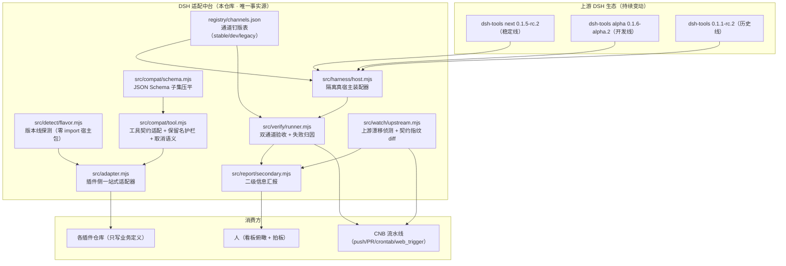

# DSH 适配中台 · 架构设计（架构八步交付物）

> Issue: #1「dsh适配的通用改造的架构」
> 角色：架构·总师 ｜ 状态：**CP1 已自验通过，待 CP2 人批准进入推广**
> 版本：`dsh-adapt-hub v0.1.1`（module `adapt-hub`，含评审 🔴 必修项修复）

---

## 0. 结论先行

**要做的事**：把「每个插件各自重复做一遍 DSH 适配」的重复劳动，抽成**一处可复用能力**；
上游（DSH）一变，只改这一处，各插件仓库不再各改一遍。

**两个版本的能力**（用户原话的直接落地）：

| 能力 | 含义 | 验收口径 |
|---|---|---|
| **稳定版通道** | 对齐 DSH 稳定线（当前 `next` = `0.1.5-rc.2`） | **必须通过**；失败 = 插件回归，必须修 |
| **开发版通道** | 对齐 DSH 开发线（当前 `alpha` = `0.1.6-alpha.2`） | **必须跑**；失败时**归因**：上游漂移 / 插件回归 |

**关键判断**：开发版通道越不稳定，本中台价值越高——它把「不稳定」变成**可自动侦测的信号**，
而不是等人到各个仓库去翻日志。这正是用户点出的「适配了它的不稳定才需要频繁调整」。

**已实测跑通**（非纸面设计）：

```
stable(0.1.5-rc.2)  ✅ 17/17 检查通过   flavor=modern
dev   (0.1.6-alpha.2) ✅ 17/17 检查通过   flavor=modern
legacy(0.1.1-rc.2)  ✅ 17/17 检查通过   flavor=legacy
离线单测 59 项 + 归因离线回归 43 项 + 发布面自检 16 项 ✅   归因端到端回归 28 项 ✅   负例插件被正确拦下 ✅   上游侦测可用（基线防自毁）✅
```

---

## 一、调研（Step 1）

### 1.1 需求方（人）要什么

| 诉求（原话拆解） | 落地为 |
|---|---|
| 「其他生态的插件想适配 dsh 生态」 | 插件侧只写业务定义，适配逻辑收归中台 |
| 「dsh 生态持续变动 → 频繁改适配」 | 版本线探测 + 契约兼容层 + 契约指纹漂移侦测 |
| 「重复劳动价值低，应形成功能」 | 一个可被 N 个仓库调用的适配中台（桥头堡），不是 N 份复制脚本 |
| 「两个版本的能力：稳定版 / 开发版」 | 双通道验收（stable / dev），另有 legacy 历史线守门 |
| 「开发版不稳定，价值更高」 | dev 通道必跑 + **失败归因**（上游漂移 ≠ 插件 bug） |
| 「跟着官方文档和新版本做适配」 | 钉版表 + dist-tag 侦测 + crontab 每日扫描 |

### 1.2 现状（调研实测，非推测）

**A. CNB 平台侧能力**（来源：官方文档 `docs.cnb.cool`）

| 能力 | 用途 | 文档 |
|---|---|---|
| `web_trigger` | 页面按钮手动触发 + `inputs` 传参（支持 `select` 等 8 种类型） | `/zh/build/web-trigger` |
| `crontab:` 事件 | 定时侦测上游漂移（最小间隔 5 分钟） | `/zh/build/crontab` |
| `include` / `imports` / `optionsFrom` / `settingsFrom` | 跨仓库引用模板与配置（桥头堡调用链） | `/zh/build/file-reference` |
| `api_trigger` + `npc.name` | 外部系统以 NPC 身份触发流水线 | `/zh/build/npc-integration` |
| `npc:go` + Skills | AI 驱动的自动化任务 | `/zh/build/internal-steps/npc/go` |

**B. DSH（DeepSeek Harness）上游现状**（npm registry 实测）

| 包 | dist-tags 实测 | 说明 |
|---|---|---|
| `@deepseek-ai/dsh-tools` | `latest=0.0.1-rc.1`（残留）/ `next=0.1.5-rc.2` / `alpha=0.1.6-alpha.2` | **`latest` 是历史残留，不可作为稳定线判据** |
| `@deepseek-ai/dsh` | `latest=0.1.5-rc.2` / `alpha=0.1.6-alpha.2` | CLI（profile / plugin 管理） |
| `@deepseek-ai/cordis` | `latest=4.0.2` | 插件容器 |

**C. 兄弟仓库已有实践**（调研，避免重复造轮子）

| 仓库 | 已有什么 | 与本中台关系 |
|---|---|---|
| `dongdongxiaozu/dsh-OpenLiulan` | `scripts/dsh-compat-check.mjs`：**单插件自建**的双版本适配验收 | 本中台把该模式**抽成通用能力**（其双版本思路已被验证可行） |
| `dongdongxiaozu/cangkutongyongzhichiku` | 桥头堡调用链（跨仓 `depends_on` 消费能力） | 本中台按同一「调用而非复制」原则分发 |
| `dongdongxiaozu/dongjiagoushi` | `docs/PLATFORM_ADAPTERS.md` 三入口归一化 | 本中台是其「DSH 宿主」侧的**契约层实现** |
| `dongdongxiaozu/tongyongyuanjiagoshikuangjia` | 框架/行业/整合解耦布局 | 本中台可视为「框架库」的一个基础能力 |

**结论**：DSH 适配的痛点真实存在、已有单点实践、但**缺通用中台**——本 Issue 要做的就是这个缺口。

---

## 二、顶层架构拓扑（Step 2）



### 模块清单（边界 / 依赖 / 输入输出 / 风险）

| 模块 | 文件 | 输入 | 输出 | 依赖 | 风险 |
|---|---|---|---|---|---|
| **通道钉版表** | `registry/channels.json` | 人工/侦测更新 | 通道定义 + 钉版 | 无 | [MEDIUM] 钉版过期 → 由 crontab 侦测兜住 |
| **版本线探测** | `src/detect/flavor.mjs` | `ctx.tools` 实例 | `HostProfile{flavor,evidence,signals}` | 无（零宿主 import） | [LOW] 上游改 `Config` 形状 → 有兜底指纹 + unknown 不抛错 |
| **Schema 兼容** | `src/compat/schema.mjs` | 宽松 schema | 受支持子集 schema + 违规清单 | 无 | [LOW] 子集收窄 → 违规清单显式上报 |
| **工具契约适配** | `src/compat/tool.mjs` | 作者侧工具定义 | 宿主可注册定义 | schema.mjs | [LOW] 保留名扩充 → 白名单可配置 |
| **一站式适配器** | `src/adapter.mjs` | `ctx` + 工具定义 | 注册结果 + disposer | compat/detect | [LOW] 插件侧唯一 import 面，接口稳定优先 |
| **隔离宿主装配** | `src/harness/host.mjs` | 通道 + 插件路径 | 探针结果（真宿主） | node/npm | [MEDIUM] 需网络装宿主 → 缓存 + 离线模式 |
| **双通道验收** | `src/verify/runner.mjs` | 通道 + 插件 | 报告 + 归因 | harness | [LOW] 归因误判 → 保守策略（宁可报上游漂移） |
| **上游侦测** | `src/watch/upstream.mjs` | npm registry | 漂移清单 + 契约 diff | 网络 | [MEDIUM] 网络不可达 → 返回 `offline:true`，不静默通过 |
| **二级信息汇报** | `src/report/secondary.mjs` | 验收报告 | JSON + Markdown 双视图 | 无 | [LOW] — |
| **CLI** | `src/cli.mjs` | 子命令 | 退出码 + JSON/Markdown | 以上全部 | [LOW] — |

---

## 三、可行性验证（Step 3）

**原则**：关键假设必须**用真宿主跑通**，不接受「应该没问题」。

| # | 假设 | 验证方式 | 结论 |
|---|---|---|---|
| A1 | 新旧版可同产物兼容（插件不 import 宿主包） | 隔离目录各装真宿主，装同一份插件产物 | ✅ **可行**（三通道各 17/17） |
| A2 | 版本线可探测且无需 import | 读 `tools.constructor.Config.toString()` | ✅ 可行：`ptc`→modern、`code`→legacy |
| A3 | 保留名 `run_code` 在新旧版都被拒 | 实测 `register({name:'run_code'})` | ✅ 两版均拒（措辞不同：PTC mode / Code Mode） |
| A4 | `output.schema` 受强制子集校验 | 实测注册 `{type:'json'}` | ✅ 两版均拒，措辞一致 |
| A5 | `output` 必须声明 `{schema, render}` | 实测只给 `schema` | ✅ 两版均拒（`render` 必需） |
| A6 | `exec.signal` 取消语义在新旧版均生效 | 中止后调 `execute` | ✅ 两版均 `isError=true` |
| A7 | `latest` dist-tag 可作稳定线判据 | 实测 npm dist-tags | ❌ **不可**：`dsh-tools@latest` 停在 `0.0.1-rc.1`（残留），改用 `next` |
| A8 | CNB 能跨仓库复用本中台（非复制） | 读官方 `include` / 桥头堡文档 | ✅ 可行（`include` + `optionsFrom`；跨私有仓需 `allow_slugs`） |
| A9 | `crontab` 可做上游每日侦测 | 读官方文档（最小间隔 5 分钟） | ✅ 可行（本仓用每日 03:30） |
| A10 | `web_trigger` 可传参做手动验收 | 读官方文档（8 种 `inputs` 类型） | ✅ 可行（已配按钮，含 `select` 通道选择） |

**暂缓项（显式标注，不静默）**：

| 项 | 原因 | 何时做 |
|---|---|---|
| npm 包发布（`@dongdongxiaozu/dsh-adapt-hub`） | 需人拍板发布策略与包名归属 | CP2 后 |
| 一键批量体检 N 个插件仓库 | 需先确认插件清单与跨仓授权（组织级开关） | CP2 后 |
| PTC-only SDK 语义增强（`presentAs('ptc')` 等） | 上游仍在 alpha，过早绑定 = 新的适配债 | 上游进入 rc 后 |

---

## 四、工程实施方案（Step 4）

### 4.1 目录结构

```
tongyongzhuandshshipei/
├── package.json                       # @dongdongxiaozu/dsh-adapt-hub（bin: dsh-adapt）
├── .cnb.yml                           # push/PR 双通道验收 + crontab 漂移侦测 + web_trigger
├── .cnb/web_trigger.yml               # 页面按钮：双通道验收 / 上游漂移侦测
├── registry/
│   ├── channels.json                  # ★ 通道钉版表（唯一事实源）
│   └── contract-snapshots/latest.json # ★ 契约指纹基线（漂移对比用）
├── src/
│   ├── cli.mjs                        # matrix / verify / watch / report / detect
│   ├── adapter.mjs                    # 插件侧唯一 import 面
│   ├── index.mjs                      # 公共导出
│   ├── detect/{index.mjs,flavor.mjs}  # 版本线探测（+ 导出面）
│   ├── compat/{schema,tool}.mjs       # 契约兼容层
│   ├── harness/{host.mjs,probe-template.mjs}  # 隔离真宿主装配 + 探针
│   ├── verify/runner.mjs              # 双通道验收 + 归因
│   ├── watch/upstream.mjs             # 上游侦测 + 契约 diff
│   └── report/secondary.mjs           # 二级信息汇报
├── templates/adapter/                 # 新插件接入模板（拷贝即用）
├── tests/
│   ├── test_offline.sh                # 59 项离线单测（无网可跑）
│   ├── test_attribution.mjs           # 43 项归因离线回归（契约采集无残留 + 判据结构化 + 判据表完备性）
│   ├── test_e2e_regression.mjs        # 28 项归因端到端回归（真宿主；🔴-A / 🔴-B 复现）
│   ├── test_exports.mjs               # 发布面自检（exports 全解析 + 模板拷贝可用）
│   ├── test_hub.sh                    # 双通道真宿主验收编排
│   └── fixtures/{demo,broken}-plugin.mjs
└── docs/{ARCHITECTURE,ADAPTER_GUIDE,RISKS,INDEX}.md
```

### 4.2 接口契约（对外承诺，改动需走版本号）

**① 插件侧（唯一需要 import 的面）**

```js
// 推荐子路径（也可从根导出面取，二者等价）
import { createAdapter } from '@dongdongxiaozu/dsh-adapt-hub/adapter';

export const inject = ['tools'];                    // 新旧版语义一致

export function apply(ctx) {
  const adapter = createAdapter(ctx, { prefix: 'myplugin' });
  adapter.register([
    {
      name: 'myplugin_echo',                        // 不得命中保留名（run_code）
      description: '...',
      parameters: { type: 'object', properties: { text: { type: 'string' } } },
      output: { schema: { type: 'object', properties: { text: { type: 'string' } } } }, // render 可省略
      execute: async (args, exec) => ({ text: args.text }),                            // exec.signal 自动守
    },
  ]);
}
```

**② CLI 契约（退出码即信号）**

| 命令 | 退出码 | 含义 |
|---|---|---|
| `dsh-adapt matrix` | 0 | 打印通道矩阵 |
| `dsh-adapt verify --channel stable\|dev\|legacy\|all` | 0 = GREEN；1 = 有失败；2 = 用法/参数错误 | 验收（`all` = stable+dev+legacy） |
| `dsh-adapt watch` | 0 = 无漂移；1 = 有漂移；2 = 离线 | 上游侦测 |
| `dsh-adapt report --markdown` | 同 verify | 二级信息 |

**③ 通道定义契约（`registry/channels.json`）**

```json
{
  "channels": {
    "<name>": {
      "label": "人类可读名",
      "intent": "该通道存在的理由",
      "npmTag": "next | alpha | null",
      "line": "版本线前缀，如 0.1.5",
      "flavorExpected": "modern | legacy",
      "pins": { "<pkg>": "<exact version>" },
      "riskNote": "该通道的风险说明（可选）"
    }
  },
  "trackedPackages": ["@deepseek-ai/dsh-tools", "..."]
}
```

---

## 五、分工与协作规则（Step 5）

| 角色 | 职责 | 触发方式 | 产物 |
|---|---|---|---|
| **架构·总师**（本角色） | 架构设计、可行性验证、风险暴露 | `@dongdongxiaozu/dongjiagoushi(架构·总师)` | 本文档 + 中台骨架 |
| **架构·开发** | 按 §4 实施 / 修 check 失败项 | `@...架构·开发` + 指向失败 check | PR |
| **架构·评审** | 审「是否真的用真宿主验收」 | `@...架构·评审` | 评审结论 |
| **架构·测试** | 跑 `tests/test_hub.sh` 复现 | `@...架构·测试` | 测试报告 |
| **上游侦测（无人值守）** | 每日 crontab 扫 dist-tag | `crontab: 30 3 * * *` | `.ci/watch.json` |
| **人（拍板者）** | CP1/CP2/CP3 放行、风险承担 | Issue 评论 | 决策记录 |

**接力规则**：失败 → 记录失败原因（`checks[].name` + `detail`）→ 归因（上游漂移 / 插件回归）→ 交对应角色；
**禁止**为「过验收」改验收标准；**禁止**吞异常。

---

## 六、进度对齐（Step 6）

| 里程碑 | 内容 | 状态 |
|---|---|---|
| M1 调研 | 平台能力 + 上游现状 + 兄弟仓实践 | ✅ done |
| M2 拓扑 | 架构图 + 模块清单 | ✅ done |
| M3 可行性 | A1–A10 十项假设（真宿主验证） | ✅ done |
| M4 工程 | 中台核心 + 双通道 + 侦测 + 汇报 | ✅ done |
| M5 自验 | 三通道 17/17 + 离线 59 项 + 归因离线回归 43 项 + 发布面自检 16 项 + 归因端到端回归 28 项 + 负例拦下 | ✅ done |
| M6 文档 | 架构/接入/风险/索引 | ✅ done |
| M7 推广 | 接入首个真实插件（建议 `dsh-OpenLiulan`） | ⏸ **待 CP2 人批准** |
| M8 发布 | npm 包 / 组织级跨仓批量体检 | ⏸ **待 CP2 人批准** |

**暂停确认点**

- ⏸ **CP1（计划）**：架构 + 可行性已自验 → 本 Issue 汇报，等放行。
- ⏸ **CP2（推广）**：接入真实插件仓库、发布 npm 包、开组织级跨仓开关 —— **必须人批准**（涉及跨仓授权与额度）。
- ⏸ **CP3（合并）**：PR 合入 main —— 需评审通过 + 人批准。

---

## 七、索引建立（Step 7）

| 产物 | 位置 | 用途 |
|---|---|---|
| 架构设计 | `docs/ARCHITECTURE.md` | 本文档 |
| 插件接入指南 | `docs/ADAPTER_GUIDE.md` | 新插件 5 分钟接入 |
| 风险清单 | `docs/RISKS.md` | 显式暴露 + 规避方案 |
| 能力索引 | `docs/INDEX.md` | 一页找齐 |
| 通道钉版表 | `registry/channels.json` | 唯一事实源 |
| 契约指纹基线 | `registry/contract-snapshots/latest.json` | 漂移对比 |
| 验收执行器 | `src/verify/runner.mjs` | CI 调用 |
| 页面按钮 | `.cnb/web_trigger.yml` | 人不用记命令 |
| CI 流水线 | `.cnb.yml` | push/PR/crontab/web_trigger |

---

## 八、汇报与复盘（Step 8）

### 8.1 决策摘要

| 决策 | 状态 | 依据 |
|---|---|---|
| 做「中台」而非「各仓复制脚本」 | 已定 | 用户原话「重复的部分形成一个功能」 |
| 稳定线取 `next` 而非 `latest` | 已定（**建议人确认**） | 实测 `latest` 停在 `0.0.1-rc.1` 残留 |
| 双通道 = stable + dev；legacy 作历史守门 | 已定 | 用户原话「两个版本的能力」 |
| dev 失败需归因（上游漂移 ≠ 插件 bug） | 已定 | 「越不稳定价值越高」→ 需区分信号 |
| 插件侧零 `@deepseek-ai` import | 已定 | 避免把 peer 版本钉死（适配债根因） |
| 是否长期保留 legacy 通道 | **需人拍板** | 官方已不再演进 0.1.1 线 |
| 是否发布 npm 包 / 开组织级跨仓 | **需人拍板** | 涉及发布策略与授权范围 |

### 8.2 风险清单

见 `docs/RISKS.md`（含 [HIGH/MEDIUM/LOW] + 规避方案 + 触发条件）。

### 8.3 复盘四要素

| 要素 | 内容 |
|---|---|
| **做对了** | ① 先真宿主验证再设计（A7 直接推翻「用 latest 当稳定线」的想当然）；② 把「归因」做成核心能力而非附属；③ 插件侧零宿主 import |
| **做错了/差点错** | 初版 schema 校验器把「无 type 节点」误判为违规（实测宿主接受）——靠真宿主验收抓到，已修 |
| **没做** | npm 发布、跨仓批量体检、PTC-only 增强（均显式暂缓，非遗忘） |
| **下一步** | CP2 放行后：接首个真实插件 → 验证「改中台一处、插件零改动」的闭环 |
